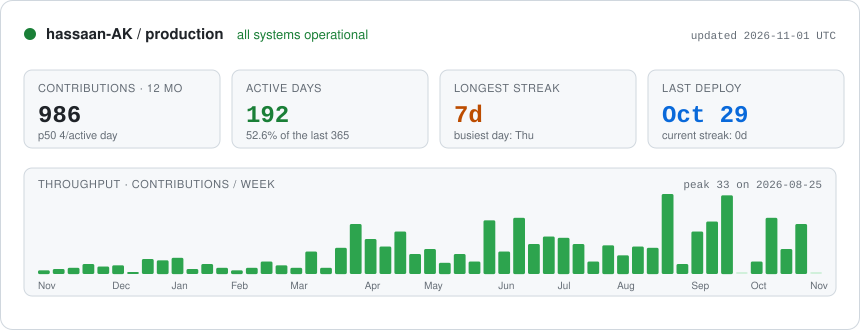

<picture>
  <source media="(prefers-color-scheme: dark)" srcset="assets/hero-dark.svg">
  
</picture>

<p align="center">
  <b>Backend engineer</b> building production Node.js / TypeScript systems from Lahore, Pakistan · open to remote roles<br>
  <a href="https://www.linkedin.com/in/hassaan-ak/">LinkedIn</a> ·
  <a href="mailto:hassaanasifkhan@gmail.com">Email</a> ·
  <a href="https://dopamineclub.pk">dopamineclub.pk</a>
</p>

## `GET` this README

Most of my code lives in private client repos, so this profile is a small live API instead.
Pick a request: it opens a pre-filled issue, a GitHub Action replies with a JSON response in about 30 seconds, and your call shows up in the log below.

| Request | Response |
|---|---|
| [`GET /whoami`](https://github.com/hassaan-AK/hassaan-AK/issues/new?title=api%3A%20GET%20%2Fwhoami&body=Just%20press%20%2A%2ACreate%2A%2A%20%28or%20%2A%2ASubmit%20new%20issue%2A%2A%29.%20A%20GitHub%20Action%20answers%20this%20request%20in%20about%2030%20seconds%2C%20then%20logs%20it%20on%20my%20profile.) | who I am, in one JSON object |
| [`GET /stack`](https://github.com/hassaan-AK/hassaan-AK/issues/new?title=api%3A%20GET%20%2Fstack&body=Just%20press%20%2A%2ACreate%2A%2A%20%28or%20%2A%2ASubmit%20new%20issue%2A%2A%29.%20A%20GitHub%20Action%20answers%20this%20request%20in%20about%2030%20seconds%2C%20then%20logs%20it%20on%20my%20profile.) | what I run in production |
| [`GET /projects`](https://github.com/hassaan-AK/hassaan-AK/issues/new?title=api%3A%20GET%20%2Fprojects&body=Just%20press%20%2A%2ACreate%2A%2A%20%28or%20%2A%2ASubmit%20new%20issue%2A%2A%29.%20A%20GitHub%20Action%20answers%20this%20request%20in%20about%2030%20seconds%2C%20then%20logs%20it%20on%20my%20profile.) | what I built and what I owned |
| [`GET /uptime`](https://github.com/hassaan-AK/hassaan-AK/issues/new?title=api%3A%20GET%20%2Fuptime&body=Just%20press%20%2A%2ACreate%2A%2A%20%28or%20%2A%2ASubmit%20new%20issue%2A%2A%29.%20A%20GitHub%20Action%20answers%20this%20request%20in%20about%2030%20seconds%2C%20then%20logs%20it%20on%20my%20profile.) | how long I've been shipping |
| [`POST /hire`](https://github.com/hassaan-AK/hassaan-AK/issues/new?title=api%3A%20POST%20%2Fhire&body=Just%20press%20%2A%2ACreate%2A%2A%20%28or%20%2A%2ASubmit%20new%20issue%2A%2A%29.%20A%20GitHub%20Action%20answers%20this%20request%20in%20about%2030%20seconds%2C%20then%20logs%20it%20on%20my%20profile.) | opens a thread I get notified about |
| [`BREW /coffee`](https://github.com/hassaan-AK/hassaan-AK/issues/new?title=api%3A%20BREW%20%2Fcoffee&body=Just%20press%20%2A%2ACreate%2A%2A%20%28or%20%2A%2ASubmit%20new%20issue%2A%2A%29.%20A%20GitHub%20Action%20answers%20this%20request%20in%20about%2030%20seconds%2C%20then%20logs%20it%20on%20my%20profile.) | try it |

**Request log**
<!--REQUEST_LOG_START-->
| Time (UTC) | Caller | Request | Status |
|---|---|---|---|
| — | — | waiting for the first request | — |
<!--REQUEST_LOG_END-->

## Production changelog

Private repos, public receipts.

```diff
@@ 2026 @@
+ Oct  Hardened a video-messaging backend: OTP bypass gone, secrets in AWS SSM, signed video URLs
+ Aug  SealPact: closed 15+ security audit findings, removed Firebase, pinned Stripe API versions
+ Jul  OpenTelemetry traces, metrics and logs across NestJS services
+ Mar  Took sole ownership of SealPact, a legal e-signature SaaS used by US engineering firms
+ Mar  Real-time chat package v1.9: Socket.IO + Redis presence, coalesced push notifications
+ Feb  URY super-app: time-decay feed ranking, OpenSearch marketplace search, BullMQ workers
@@ 2025 @@
+ Dec  Started Dopamine Club, a live PC-hardware marketplace (NestJS, Next.js, Redis)
+ Jul  National Ramp: recovery workflows and Epicor ERP integration (540+ commits since 2024)
@@ 2024 @@
+ Jun  AI Transcriptor: OpenAI Whisper pipeline for searchable meeting transcripts
+ Jan  MLT: multilingual AI messaging platform with offline Arabic-English translation
```

## Telemetry

<picture>
  <source media="(prefers-color-scheme: dark)" srcset="assets/telemetry-dark.svg">
  
</picture>

<picture>
  <source media="(prefers-color-scheme: dark)" srcset="assets/snake-dark.svg">
  
</picture>

## Stack

<picture>
  <source media="(prefers-color-scheme: dark)" srcset="https://skillicons.dev/icons?i=ts,nodejs,nestjs,mongodb,postgres,redis,aws,docker,githubactions,python,react,nextjs&theme=dark">
  
</picture>

## Right now

- Building **Dopamine Club**, a community marketplace for verified PC hardware
- Learning AI engineering in public with **RigBuilder AI**: Python, RAG and agents
- Looking for a remote backend role with a team that cares about reliability

<sub>The header, the dashboard and the README API are generated by the scripts in this repo. Fork it and make it yours.</sub>
